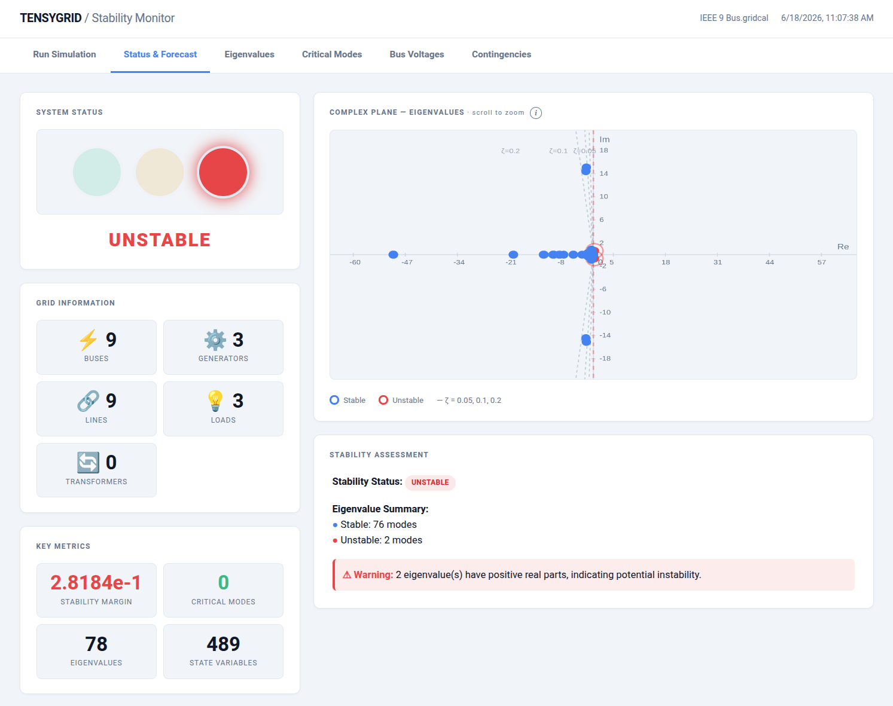

# VeraGrid · TenSyGrid


**An open-source research toolbox for assessing the stability of power grids with high shares of renewable generation.**

As wind, solar and batteries connect to the grid through power electronic converters, their controls can interact with each other and with the network. The [TenSyGrid project](https://tensygrid.eu/project/) develops modelling and analysis methods to help engineers understand when such interactions lead to poorly damped or growing oscillations. This repository integrates the toolbox with [VeraGrid](https://github.com/SanPen/VeraGrid), reusing its grid models, file importers and power-flow solvers.

## How it works

We assemble the equations for network components and their controls into a single grid model. In the implicit multilinear formulation, each variable enters at most linearly when the others are held fixed, but products such as $xy$ still capture nonlinear interactions. For example, $f(x,y)=a+bx+cy+dxy$ has four coefficients that fit in a $2\times2$ array. With more variables, the same idea gives a tensor, an array with one axis per variable. Sparse or low-rank representations can make these models cheaper to store and evaluate when the structure allows it.

For a small-signal study, the toolbox first solves a power flow to find the operating point. It then linearises the dynamic equations and algebraic constraints around that point and solves a generalised eigenvalue problem. The resulting modes show how small disturbances decay or grow and, for oscillatory modes, at what frequency.

## Installation

Follow the [installation and GUI startup guide](INSTALLATION.md) to install Git and Python, clone the repository, create a virtual environment, install the dependencies and open the Stability Monitor in your browser.

## Try it on a nine-bus grid

From the repository root, in an activated Python environment, install the dependencies with `python -m pip install -r requirements.txt matplotlib`. See [BUILD.md](BUILD.md) for the broader VeraGrid source setup. The following example loads a bundled IEEE 9-bus model with a synchronous generator and grid-forming and grid-following converters, runs a phasor (RMS) stability study and prints the eigenvalue with the largest real part.

```bash
PYTHONPATH=src python - <<'PY'
from TensyGridEngine.small_signal_analysis_main import (
    load_grid,
    run_small_signal_analysis,
    set_models,
)

grid = load_grid("ieee9_stamp_gfor_gfol_phasor_rms.veragrid")
set_models(grid)
result = run_small_signal_analysis(grid)
eigenvalues = result["eigenvalues"]
print(f"Rightmost eigenvalue: {max(eigenvalues, key=lambda mode: mode.real):.4g}")
PY
```

A positive real part indicates a growing mode. A negative real part indicates a decaying mode, and values close to zero warrant a closer look.

## Explore the Stability Monitor

The browser-based research interface lets you launch stability studies and inspect the eigenvalue spectrum, damping, critical modes and bus voltages. From the same environment, start it locally and open [localhost:8550](http://localhost:8550). If that port is occupied, choose another port as explained in the [installation guide](INSTALLATION.md#6-if-the-port-is-already-in-use). Use the URL printed in the terminal for the running server.

```bash
PYTHONPATH=src python -m uvicorn TensyGridEngine.gui.dashboard:app --host 127.0.0.1 --port 8550
```



The Stability Monitor is a research prototype. You can use it to run studies on the bundled example grids and explore their stability results.

## Repository layout

- [`src/TensyGridEngine/`](src/TensyGridEngine/) contains the analysis workflows, experiments and web interface.
- [`src/VeraGridEngine/`](src/VeraGridEngine/) provides the shared grid models, numerical solvers and file I/O.
- [`Grids_and_profiles/grids/`](Grids_and_profiles/grids/) contains example networks, including the case above.

## Consortium and funding

[TenSyGrid](https://tensygrid.eu/project/) is a collaboration across Germany, Spain and Malta, coordinated by **Fraunhofer IWES**. The other partners are **Universitat Politècnica de Catalunya (CITCEA-UPC)**, **eRoots Analytics**, **Hamburg University of Applied Sciences (HAW Hamburg)** and the **University of Malta**.

<p>
  
  
  
  
  
</p>

The research is funded through the **Clean Energy Transition Partnership (CETPartnership)** 2023 Joint Call, co-funded by the **European Commission** (grant agreement 101069750). The national funding bodies are BMWE in Germany, MICIU, AEI and CDTI in Spain, and Xjenza Malta. [Funding details](https://tensygrid.eu/project/) · [National funding bodies](https://www.iwes.fraunhofer.de/en/press-media/archive-2025/assessing-the-stability-of-power-grids-with-high-levels-of-renew.html)

<p>
  
  
</p>

[TenSyGrid publications and tutorials](https://tensygrid.eu/resources/) · [Contributing](CONTRIBUTING.md) · [MPL 2.0 licence](LICENSE.md)
