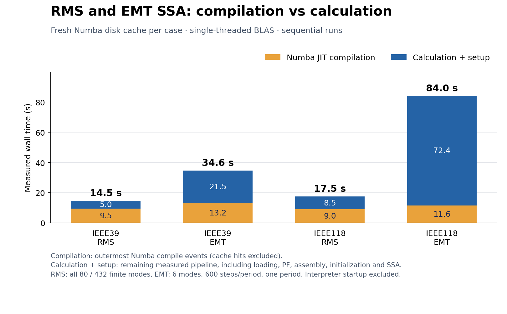

# Verified RMS SSA and RMS/EMT timing comparison

Both RMS cases now pass the original symbolic-equation equilibrium check, an independent S/Phi representation check at three points, and full descriptor eigenpair checks. The earlier RMS rejection was an exporter representation error: rational P/Q-to-current terms were silently omitted. For multilinear AC injection models exposing current ports, assembly now consumes those ports directly. Power-flow voltages are unchanged; no Newton correction or artificial network element was used.

## Compilation and calculation



[Vector plot](phase_comparison/rms_emt_compilation_calculation.svg) · [Exact timing data](phase_comparison/summary.json)

| Case | Numba compilation (s) | Calculation + setup (s) | Total (s) |
|---|---:|---:|---:|
| IEEE39 RMS | 9.53 | 4.98 | 14.51 |
| IEEE39 EMT | 13.18 | 21.47 | 34.65 |
| IEEE118 RMS | 8.98 | 8.47 | 17.45 |
| IEEE118 EMT | 11.59 | 72.39 | 83.98 |

These are individual sequential first-use measurements, with a fresh separate Numba disk-cache directory per case and single-threaded BLAS. Compilation measures outermost `numba:compile` events, excluding disk-cache hits. Calculation + setup is the remaining measured pipeline: loading, power flow, assembly, cache loading, initialization, validation and SSA. Interpreter startup and initial imports are outside the timer. Other caches were unchanged. These are not the previous warm-cache fastest EMT measurements.

RMS computes all finite modes (80 and 432); EMT computes six Floquet modes using 600 steps over one period. Different model equations and spectrum sizes mean these timings compare the configured workflows, not equivalent eigenvalue problems.

## RMS with normal caches

A separate sequential verification using normal caches gave:

| Grid | Total (s) | SSA (s) | Finite modes | Initial residual | Full-pencil backward error |
|---|---:|---:|---:|---:|---:|
| IEEE39 | 6.71 | 0.276 | 80 | 1.52e-10 | 1.65e-16 |
| IEEE118 | 11.22 | 2.113 | 432 | 4.08e-13 | 9.49e-16 |

[Verification summary](summary.json) records exact values and source hashes. Maximum S/Phi representation errors were 1.78e-14 and 9.77e-15. Both power-flow voltage differences were exactly zero. IEEE39's maximum real part is 2.55e-14 /s (numerically neutral); IEEE118 has a positive mode at 0.34146 /s for this configured model. Neutral lifted/gauge modes are retained. RMS uses GENQEC models; its spectrum should not be identified with the EMT single-field-machine spectrum.

The benchmark eliminates the invertible algebraic block with sparse LU, then solves the reduced generalized eigenproblem. It reconstructs right eigenvectors and validates them against the original full descriptor pencil. It applies no diagonal regularization. The engine's legacy full RMS solver is unchanged; selecting the benchmark's legacy `full` option records its 1e-7 regularization explicitly. This reduction requires an invertible algebraic block and nonsingular reduced derivative matrix; it fails explicitly otherwise. It does not compute participation factors.

## Reproduction and validation

```bash
python trunk/benchmarks/verify_rms_benchmarks.py --output trunk/benchmarks/rms_ssa
python trunk/benchmarks/measure_rms_emt_phases.py --output trunk/benchmarks/rms_ssa/phase_comparison
python trunk/benchmarks/plot_rms_emt_phases.py
```

The recorded runs used an isolated export of the staged engine sources, excluding unrelated working-tree changes. Each runner verifies source fingerprints and numerical checks before reporting success. Large EMT trajectory captures are reproducible and ignored; compact JSON, mode CSVs and logs are saved here.

Validation: 21 focused RMS tests and 78 cross-regression tests passed in the isolated source export. Tests include comparison against an unregularized descriptor pencil, a real two-bus generator model, and rejection of an intentionally omitted rational term. See [focused test log](rms-regression.log) and [cross-regression log](cross-regression.log).
