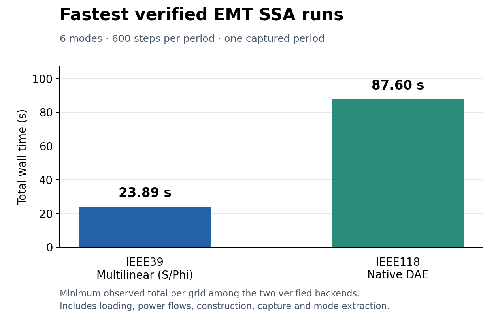

# Verified EMT SSA: staged source from load to modes

> **RMS follow-up:** [RMS SSA results](../rms_ssa/README.md) correct the cause of the
> earlier RMS rejections below. The symbolic PF equilibrium was valid; the old
> S/Phi export omitted rational generator-current terms. Current RMS runs use
> existing current ports and validate the export independently. The historical
> RMS rejection records below describe that old exporter, not a bad equilibrium.


All four runs below passed from an exported **Git-index snapshot**, not from the
working tree. The export contained the staged engine, benchmark scripts and
tracked grid inputs. It included the remaining generator and transformer fixes.
The verifier launches fresh processes sequentially and verifies that each imports
its engine from that exported checkout. `summary.json` contains source fingerprints;
individual JSON records also contain input-grid and transformer-helper hashes.

The earlier performance commits alone omitted these physical-model corrections;
this combined commit includes them and the harness needed to reproduce the
corrected results. These custom multilinear templates belong to TenSyGrid and
are not present in the sibling VeraGrid checkout. Its initialization speedups
were already committed separately.

## Configuration and checks

Both backends use exactly the same auxiliary device equations, balanced and
three-phase PF, dispatch, generic machine sequence assumptions and held
PF-initialized inputs. Six modes, Krylov dimension 24, 600 steps per fundamental
period, one captured period, trapezoidal integration and StructuralAD capture.
`Multilinear` uses the S/Phi evaluator; `CurrentBalance` uses native StructuralAD
Jacobian evaluation. Both use the existing consistent-tangent option; this is
not an on/off test of that feature.

The runner and verifier require both PFs to converge, a finite initial DAE
residual <=1e-6, a complete finite captured period, scaled closure <=1e-4 and
six finite exponents. The verifier also checks engine/runner/grid provenance,
mode-family agreement <=1e-6 /s and trajectory agreement <=1e-8. Conjugate
representatives at the requested-mode cutoff are compared as the same family.
The measured trajectory differences were zero.

These are implementation benchmarks with generic dynamic data, not validated
standard IEEE dynamic-data studies. Cycle closure at a declared tolerance is
not certification of an exact periodic orbit or of every physical-model
assumption. No outages, redispatch or extra independent terminal devices were
introduced. IEEE39's stored fBase is 50 Hz; IEEE118's is 60 Hz.

## Fastest verified runs



Only the minimum observed total for each grid from this verification is shown:
IEEE39 **23.89 s** (S/Phi) and IEEE118 **87.60 s** (native DAE). This is a selection
of individual observed runs, not a claim that the selected backend is always
faster. [SVG export](fastest_runs.svg).

Regenerate directly from the committed summary:

```sh
python trunk/benchmarks/plot_fastest_runs.py
```

## Fresh observations

| Grid/backend | Total (s) | Construction (s) | SSA incl. capture (s) | Scaled cycle closure | Largest real exponent (/s) |
|---|---:|---:|---:|---:|---:|
| ieee39/Multilinear | 23.89 | 0.91 | 16.29 | 5.74313e-05 | 243.042874 |
| ieee39/CurrentBalance | 24.21 | 0.89 | 16.45 | 5.74313e-05 | 243.042874 |
| ieee118/Multilinear | 88.22 | 13.81 | 61.45 | 8.81518e-05 | 35.241446 |
| ieee118/CurrentBalance | 87.60 | 14.38 | 60.29 | 8.81518e-05 | 35.241446 |

Mode-family differences between backends: IEEE39
1.26e-11 /s; IEEE118
2.32e-12 /s.
The numerical growth rates remain positive for these configured models.

Timings are individual wall-clock observations, with one BLAS/OpenMP thread.
No other benchmark or regression suite was run concurrently with these four
cases. The engine's ordinary cache behavior is retained; these are not
cache-disabled or statistical timing guarantees. Initial snapshot execution and
repeat runs can differ due to first-use compilation, filesystem/cache state and
machine activity. Earlier archived 600/105/81-second figures describe other
implementation stages or timing conditions and do not replace this table.

Engine Python-source fingerprint:
`ee37b8b3ca6940774e6160a5df94216bdc61be5506b62885fe44fab1ff9d6c65`.

Runner and verifier fingerprints are recorded in `summary.json`; hashing uses
relative Python paths and contents, so it does not depend on the checkout path.
All four individual records assert the same engine fingerprint.

## Checks that must reject invalid setups

The same exported source was also exercised on four negative controls. No mode
CSV was produced in any rejected case:

| Setup | Rejection | Measured residual/error |
|---|---|---:|
| IEEE39 RMS, old exporter | Before SSA: incorrect S/Phi residual | 8.86235 |
| IEEE118 RMS, old exporter | Before SSA: incorrect S/Phi residual | 5.94264 |
| IEEE39 standard non-lifted EMT templates | Cycle closure exceeds 1e-4 | 0.00174152 |
| IEEE118 standard non-lifted EMT templates | Before capture: initial DAE residual exceeds 1e-6 | 0.00103544 |

These are correctly reported failures, not successful SSA timing measurements.
The RMS export issue is now corrected and separately verified in the linked
RMS report. Fully standard non-lifted EMT model comparisons still require
initialization/periodicity work and are not silently passed.
Diagnostic overrides are explicit (`--allow-nonequilibrium` or
`--allow-nonperiodic`) and do not turn a failed validation flag into a pass.
See `rejection_checks/summary.json` and each JSON/log.

## Reproduce from the committed checkout

With the normal project dependencies installed and the environment activated:

```sh
OPENBLAS_NUM_THREADS=1 OMP_NUM_THREADS=1 python trunk/benchmarks/verify_emt_benchmarks.py
```

This regenerates all four full runs and their comparisons under
`trunk/benchmarks/results/end_to_end/`. A failed child or validation check exits
nonzero. For an individual case:

```sh
python trunk/benchmarks/multilinear_ssa.py --grid ieee118 --formulation emt \
  --emt-problem Multilinear --emt-models auxiliary --steps-per-period 600 \
  --assessment-periods 1 --modes 6 --krylov-dim 24 --output /tmp/ieee118_ssa
```

Use `--emt-problem CurrentBalance` for the native backend or `--grid ieee39`.
`--all` in the general runner additionally includes RMS cases;
RMS now passes its independently checked equilibrium with the export correction;
the historical RMS negative controls above belong to the earlier source revision.
It is not the four-EMT-case verification command above.

For a current rejection check, select
`--emt-problem CurrentBalance --emt-models canonical --capture-only` for standard
EMT templates. RMS is no longer an expected rejection after the export correction.

The commit keeps compact JSON, CSV, logs and this report. Large NPZ trajectory
captures, saved-grid files and profiles are regenerated and ignored by Git.
Comparisons above were computed from the regenerated NPZ arrays during the run;
not committing those arrays does not omit any source, model parameter or input
needed to reproduce them.

## Regression evidence

**78 tests passed** in 25.89 s from the same exported Git-index snapshot, covering generator
operating points and flux/power conventions, transformer terminal attachment,
off-nominal PF equivalence and nonzero branch resistance, passive transformer
termination, cycle closure, all three discrete Jacobian methods, solver-backend dispatch/period-map behavior, monomial zero rules and sparse constraint reduction.
One existing autograd/NumPy deprecation warning remains. See `regression_tests.log`.
